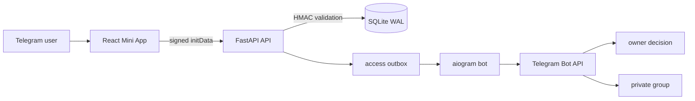

# kernel

`kernel` is a full-stack Telegram application that combines a bot, a React
Mini App, a FastAPI backend, and a small production-oriented Linux deployment.
It provides a controlled workflow for requesting access to a private Telegram
group while also supporting an owner-mediated contact channel.

This repository is a sanitized portfolio edition. It contains no production
credentials, Telegram user data, SQLite database, server inventory, backups,
or private deployment history.

> **Project status:** the bot, API, Mini App, persistence layer, and automated
> core tests are included. The infrastructure files are reviewed examples, not
> an automatic deployment system. A live URL will be added only after the
> current production rollout has been independently verified.

## What it does

- Validates signed Telegram Mini App `initData` on the backend.
- Exchanges one-time Telegram proof for a short-lived bearer session.
- Lets a user inspect their access state and submit an idempotent request.
- Restricts administrative endpoints and Telegram callbacks to the owner.
- Creates expiring join links after approval and verifies actual membership.
- Handles Telegram join requests without treating approval as membership.
- Relays user messages to the owner and routes replies back to the correct
  conversation.
- Persists delivery, replay, request, invite, membership, and routing state in
  SQLite.
- Recovers interrupted work conservatively instead of blindly resending an
  ambiguous Telegram operation.

## Architecture



The browser never chooses a Telegram identity. FastAPI derives it from signed
Telegram data, stores only a hash of each issued session token, and protects
owner routes independently. SQLite transactions end before Telegram network
calls; durable outboxes and message mappings connect the two sides safely.

See [Architecture](docs/architecture.md) for component and data-flow details.

## Technology

- Python 3.14, aiogram 3, FastAPI, Uvicorn
- React 19, TypeScript 5.9, Vite 7
- SQLite with foreign keys, WAL mode, additive transactional migrations
- Caddy for HTTPS/static assets/reverse proxy
- systemd sandboxing and a single-poller lock
- GitHub Actions for backend tests, frontend tests/typecheck/build, dependency
  audit, and secret scanning

## Repository layout

```text
backend/              FastAPI application and request-safety middleware
kernel/               shared configuration, auth, access, storage, and bot logic
frontend/             React Mini App and frontend tests
tests/                backend and Telegram integration tests with fake sessions
infra/caddy/           reviewed reverse-proxy example
infra/systemd/         reviewed service examples
docs/                  architecture, deployment, security, and operations
bot.py                 aiogram entry point
```

Production migration helpers and host-specific release scripts are deliberately
not part of this public edition.

## Local development

The complete Telegram flow requires a dedicated test bot and test group. Never
reuse production credentials for local development.

```bash
python -m venv .venv
.venv/bin/python -m pip install -r requirements-dev.txt -c infra/python-constraints.txt
cp .env.example .env
```

Replace the token and synthetic IDs in the new local `.env` with credentials
for the test environment. The committed example itself must remain synthetic.

Run the bot and API in separate terminals:

```bash
.venv/bin/python bot.py
.venv/bin/python -m backend
```

Start the frontend development server:

```bash
cd frontend
npm ci
npm run dev
```

A normal browser intentionally shows the “open through Telegram” state. It
does not emulate or invent a Telegram identity.

## Tests

Backend and bot tests use temporary SQLite databases and fake Telegram
sessions. They do not require a real token and do not call the live Telegram
API.

```bash
PYTHONDONTWRITEBYTECODE=1 .venv/bin/python -m unittest discover -s tests -v
```

Frontend checks:

```bash
cd frontend
npm ci
npm test
npm run test:react
npm run typecheck
npm run build
```

## Deployment

The API binds to loopback and is designed to sit behind HTTPS. The examples in
`infra/` use a dedicated unprivileged user, a protected environment file,
systemd filesystem restrictions, Caddy path guards, and an explicit approval
gate before either service can start.

They intentionally contain no host, IP address, SSH target, release SHA, or
automatic production action. See [Deployment](docs/deployment.md) and
[Operations](docs/operations.md) before adapting them.

## Security

Security controls and known boundaries are documented in
[docs/security.md](docs/security.md). To report a vulnerability, follow
[SECURITY.md](SECURITY.md) and do not place sensitive evidence in a public
issue.

## License

MIT — see [LICENSE](LICENSE).
